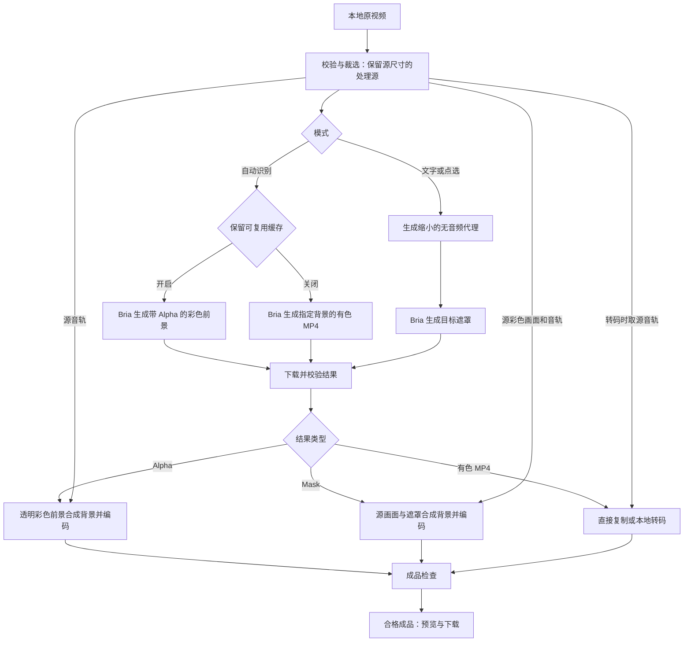

# 技术细节

## 1. 文档范围与处理原则

| 项目 | 内容 |
| --- | --- |
| 版本 | v2.0 |
| 日期 | 2026-10-24 |
| 适用模式 | 自动识别前景、文字描述目标、点选目标 |
| 范围 | 三种模式的输入、请求参数、处理分支、中间结果、合成、编码、校验、缓存、状态查询与异常恢复 |
| 官方接口资料核对日期 | 2026-10-24 |

本文描述 Cloudflare 网页/API 与浏览器本地 FFmpeg 工具的技术设计和实现约定。接口约束附官方直达链接；具体代理尺寸、合成参数、校验容差、缓存和轮询策略属于本项目工程选择；识别质量与设备播放效果另行验收。正文不记录开发进度或测试成绩。

Bria 是唯一 AI 处理服务；FFmpeg／FFprobe 负责确定性的视频解析、裁选、缩放、合成、编码和检查。输入以 2K／4K 视频为主，成品尺寸、比例和帧率跟随源视频；43 寸目标设备为 9:16 竖屏，建议输入同比例素材，第一版不自动裁剪为 9:16。时间片段裁选与画面裁剪是两个不同功能。

## 2. 三种模式总览与数据流

### 2.1 模式差异

| 模式 | 目标指定方式 | 上传素材 | 上游结果 | 最终彩色画面来源 | 后续换色 |
| --- | --- | --- | --- | --- | --- |
| 自动识别，开启缓存 | 自动保留整体前景 | 保留源尺寸的处理源片段 | 带 Alpha 的彩色前景视频 | Bria 返回的彩色前景 | 复用 Alpha，本地合成 |
| 自动识别，关闭缓存 | 自动保留整体前景 | 保留源尺寸的处理源片段 | 已合成指定背景的有色 MP4 | Bria 返回的有色画面 | 更换背景需要重新抠图 |
| 文字描述 | 描述要保留的对象 | 等比例缩小、无音频的代理 | 灰度遮罩视频 | 本地保留源尺寸的处理源片段 | 复用遮罩，本地合成 |
| 点选目标 | 同一帧的保留／排除点 | 等比例缩小、无音频的代理 | 灰度遮罩视频 | 本地保留源尺寸的处理源片段 | 复用遮罩，本地合成 |

自动识别有两条输出分支，但在界面中仍属于同一种模式。它没有文字目标或点位参数，不承诺从多个前景对象中只保留某个指定实例。

官方约束：自动接口最长 60 秒、输入最高 16000×16000；文字与点选接口最长 5 秒、最高 750p。接口地址分别为 `POST /v2/video/edit/remove_background`、`POST /v2/video/segment/mask_by_prompt`、`POST /v2/video/segment/mask_by_key_points`。[自动识别](https://docs.bria.ai/video-editing/editing/remove-background)、[文字描述](https://docs.bria.ai/video-editing/masking/mask-by-prompt)、[点选目标](https://docs.bria.ai/video-editing/masking/mask-by-key-points)。

以下“本地”均指浏览器 WASM 与 IndexedDB，不需要 Node API；上传和结果文件由 Worker 转发，签名地址留在服务端。旧 Node 实现仅作兼容回归。部署配置见 [CLOUD.md](CLOUD.md)。

### 2.2 总体数据流



### 2.3 文件职责

| 数据 | 用途与生命周期 |
| --- | --- |
| 上传原视频 | 本地保存原素材，供预览和生成处理源；不直接把完整原文件作为三种模式的统一上传对象 |
| 处理源片段 | 三种模式均生成；归一化尺寸、帧率和时间后保存。自动模式上传它，文字／点选用它提供最终画面 |
| 浏览器兼容预览 | 原素材不便在浏览器播放时生成，仅服务交互，不替代处理源 |
| 处理代理 | 仅文字／点选生成并上传；缩小且无音频，与源片段覆盖同一内容和时间范围 |
| 上游结果 | Alpha、Mask 或有色视频之一；本地下载后验证就绪状态，保留供恢复或重新导出 |
| 成品 MP4 | 通过最终检查后开放下载；任务记录、源文件、中间结果及成品保存在本地 |

处理源和代理都经过编码，不能称为原文件的无损复制。自动模式的有色直出只有最终交付步骤可能直接复制，上游前仍有源片段预处理。

## 3. 源片段与处理代理

### 3.1 本地素材校验

本地入口检查实际容器和编码，不仅依赖扩展名或 MIME。当前接受 MP4／MOV／WebM／AVI／GIF，以及 H.264、H.265、VP9、AV1、PhotoJPEG 编码；GIF 视频流作为动图特例。此列表作为本地公共输入策略；真正上传 Bria 的是预处理后的源片段或代理。[Bria 自动接口格式说明](https://docs.bria.ai/video-editing/editing/remove-background)。

单文件本地上限为十进制 1 GB；读取有效的正时长、正平均帧率且不高于 120fps，归一化后每边尺寸在 2～16000 像素。帧率和尺寸的本地保护检查不等同于上游所有端点的能力保证。损坏文件或不支持的编码在创建 AI 任务前拒绝。

### 3.2 选择与校验片段

自动模式按 60 秒、文字／点选按 5 秒检查所选片段；文字描述和点选接口官方限制为最长 5 秒、最高 750p。[文字描述接口](https://docs.bria.ai/video-editing/masking/mask-by-prompt)、[点选接口](https://docs.bria.ai/video-editing/masking/mask-by-key-points)。

选择视频或切换模式后检查时长；超过限制时显示片段范围，提交时再次校验，服务端也独立校验。文字／点选接口请求显式设置 `auto_trim=false`，不依赖上游自动截断。

源片段目标帧数按 `floor((结束时间 − 开始时间) × 源平均帧率 + 1e-6)` 计算，必须至少有一帧。预处理按该帧数与帧率约束输出时长，因此非整帧边界不保证精确保留到任意小数秒。

### 3.3 生成处理源

1. 按开始和结束时间裁出源片段，选择第一路视频及存在时的第一路音频。
2. 归一化旋转和像素宽高比，得到实际显示尺寸。
3. 根据源平均帧率生成恒定帧率视频；不承诺逐帧保留可变帧率素材的原始时间戳。
4. 为兼容 4:2:0 编码，奇数宽高向上补最多 1 像素，不改变为设备比例。
5. 视频时间从零开始；音频时间从零开始，必要时补静音至片段结束。
6. 编码为 H.264，视频质量参数 CRF 18；存在音频时转为 AAC 192kbps。读取预处理后的真实规格，作为后续配准和验收基准。

### 3.4 生成处理代理（仅文字／点选）

源片段等比例缩小至不超过 1280×720 的范围，保持偶数宽高；小素材不主动放大。代理不裁剪画面、不改变目标位置，移除音轨，以 H.264／yuv420p 编码。代理生成后再次读取真实宽高、帧率与帧数。

1280×720 是本项目选择的包围框，并不是所有素材都转换为 1280×720。例如 16:10 素材缩放为 1152×720，9:16 竖屏素材可缩放为约 404×720，具体以编码后读取的偶数尺寸为准。

## 4. 自动识别前景处理流程

### 4.1 输入与请求参数

自动模式生成并上传保留源显示尺寸的处理源片段，不走 1280×720 代理。创建任务时默认开启可复用缓存，操作者可在高级设置关闭。

| 参数 | 开启缓存 | 关闭缓存 |
| --- | --- | --- |
| `video` | 处理源片段的上传地址 | 处理源片段的上传地址 |
| `background_color` | `Transparent` | 所选预设颜色英文名称，例如 `White` |
| `output_container_and_codec` | `webm_vp9` | `mp4_h264` |
| `auto_zoom` | `false` | `false` |
| `preserve_audio` | `true` | `true` |

这些参数由项目显式设置，不依赖默认值。关闭自动缩放，以保留输入构图。官方指出透明输出需要支持 Alpha 的预设；透明颜色搭配不支持 Alpha 的编码可能回退为黑底并返回警告，项目需检查返回结果。[Bria Remove Background](https://docs.bria.ai/video-editing/editing/remove-background)。

### 4.2 开启缓存：Alpha 合成路径

1. 上传源片段，提交一次自动抠图请求，保存上游任务标识。
2. 查询完成后从 `video_url` 下载结果。此结果是带透明度的彩色前景，而不是灰度遮罩。
3. 检查时长、帧率、帧数和比例；如果上游返回输出警告，停止透明结果合成并提示核对。
4. 检查像素格式或大小写不敏感的 `alpha_mode=1` 标记，并尝试解码第一帧、运行 `alphaextract`，确认能读取透明通道。检查失败不将结果标记为可复用。
5. VP9 结果显式使用 `libvpx-vp9` 解码，避免透明度在解码时丢失。
6. 按源片段帧率重建帧序号时间戳，将上游彩色前景转为 RGBA，保留其 Alpha。
7. 将该前景叠加到所选纯色背景上，从本地源片段取音轨，编码并进行成品校验。
8. 保存 Alpha 缓存；以后换色只重新执行本地合成与导出。

最终彩色前景取自 Bria 返回结果。此分支不把 Alpha 另行提取后重新应用到本地原画面；第一帧 `alphaextract` 用于通道可用性检查，正式合成直接使用带 Alpha 的彩色前景。

### 4.3 关闭缓存：有色 MP4 路径

1. 上传源片段，向 Bria 提交所选背景色和 MP4／H.264 输出参数。
2. 下载并检查返回视频，得到已合成背景的有色画面。
3. 若宽高匹配目标、编码为 H.264、像素格式为 yuv420p，且音轨有无与源片段一致，则复制到临时成品，再执行完整导出校验；不重新编码画面，也不重新合成背景。
4. 若不满足上述快速交付条件，则本地转码：重置画面时间、等比例适配目标尺寸、必要时用所选背景色补边；使用本地源片段音轨，再编码为规定格式并校验。
5. 合格后交付成品。由于未保留可分离背景的 Alpha／Mask，更换背景色需要新建抠图任务。

快速交付条件并未替代最终校验：例如复制后的实际帧数不合格，当前实现会失败，不会自动再次转码兜底。比例、帧率或时长在前置结果检查中已超出容差时，同样先失败，不直接进入规格修正。

直复制时音频来自上游成品；本地转码时改用源片段音频。当前直接交付检查只检查音轨有无，不验证音频内容完全相同，也不额外保证其音频编码一定为 AAC。

## 5. 文字描述目标处理流程

### 5.1 输入与请求参数

目标描述去除首尾空白后必须非空，本地最多 2000 字符；这是工程保护阈值。描述用于说明要保留的对象，例如“画面中央穿红色外套的人”。项目没有自动翻译、扩写描述或逐对象拆分提交的环节。

| 参数 | 提交内容 |
| --- | --- |
| `video` | 1280×720 范围内的无音频代理地址 |
| `prompt` | 去除首尾空白后的目标描述 |
| `auto_trim` | `false` |
| `output_container_and_codec` | `mp4_h264` |

接口根据文字返回遮罩视频，项目按遮罩解析。[Bria Generate Mask by Prompt](https://docs.bria.ai/video-editing/masking/mask-by-prompt)。

### 5.2 从提交到成品

1. 校验描述和所选片段，生成保留源尺寸的处理源。
2. 从处理源生成缩小代理，保持构图、时间范围及帧序列对应关系，去掉音轨。
3. 上传代理并提交一次文字遮罩请求，保存上游请求标识。
4. 查询完成后下载 `mask_url`，兼容 `video_url` 字段；检查遮罩与处理源的时长、帧率、帧数和比例。
5. 放大遮罩至处理源尺寸，转换为灰度，作为处理源彩色画面的 Alpha。
6. 叠加所选纯色背景，从处理源取音轨，编码并检查成品。
7. 保留遮罩；换色可在本地重做第 5～6 步，修改描述则需要新的 AI 任务。

返回遮罩只决定可见区域，目标纹理和颜色来自本地处理源，不由文字重新生成。多个相似对象可能无法仅靠简短描述区分，需要通过实际预览验收。

## 6. 点选目标处理流程

### 6.1 输入约束与坐标映射

界面保存归一化坐标 `x/y`、原视频标注时间以及保留／排除类型。同一任务本地允许 1～100 个标记，必须位于同一帧，且至少包含一个保留点。坐标必须在 0～1 内，标注时间须满足开始时间 ≤ 标注时间 < 结束时间；服务端按源平均帧率核验所有点属于同一帧。

提交时换算：

```text
代理像素 x = min(代理宽度 − 1, floor(归一化 x × 代理宽度))
代理像素 y = min(代理高度 − 1, floor(归一化 y × 代理高度))
标注帧序号 = floor((标注时间 − 片段开始时间) × 代理帧率)
帧序号限制在 0 至代理总帧数 − 1 之间
```

`positive` 表示纳入目标，`negative` 表示排除区域；`frame_index` 指明标注帧。上游据此返回整段遮罩视频，本地不逐帧重新调用点选接口。[Bria Generate Mask by Key Points](https://docs.bria.ai/video-editing/masking/mask-by-key-points)。

### 6.2 请求参数与完整流程

| 参数 | 提交内容 |
| --- | --- |
| `video` | 处理代理地址 |
| `frame_index` | 所选片段内的代理帧序号，从 0 开始 |
| `key_points` | 换算后的像素坐标与 `positive`／`negative` 类型 |
| `auto_trim` | `false` |
| `output_container_and_codec` | `mp4_h264` |

1. 操作者在目标清晰的一帧暂停，添加保留点，并用排除点修正误选区域；支持撤销和清空。
2. 提交时校验标记、时长与片段范围，再生成源片段和无音频代理。
3. 按代理实际规格换算点位和帧序号，上传代理并提交一次点选遮罩任务。
4. 上游返回整段遮罩，下载后执行与文字模式相同的配准检查。
5. 将遮罩应用到本地源片段，合成背景和源音轨，编码、校验、交付。
6. 缓存遮罩供本地换色；改变点位或标注帧需要重新抠图，不复用旧遮罩来猜测新目标。

点选与文字的差异发生在目标指定及上游请求阶段。返回遮罩后的流程相同，本地没有新增一次目标识别、逐帧点选或多视频共享点位处理。

## 7. 上游结果下载与前置校验

服务端保留上游请求标识，查询原任务直至完成。自动模式读取 `video_url`；文字／点选优先读取 `mask_url`，兼容读取 `video_url`；没有结果地址时明确失败。下载先写临时文件，成功后转为正式结果；中断时清理临时文件。本地下载保护上限为 4 GB，上传和下载请求各使用 10 分钟超时，均为本项目保护策略。

对 Alpha、Mask、有色结果统一执行以下 FFprobe 检查，通过后才设置中间结果就绪标记。Alpha 还要通过第 4.2 节的透明通道检查；有色结果即使已就绪，也不具备任意换背景的能力。

| 项目 | 当前工程校验条件 |
| --- | --- |
| 文件有效性 | 能解析支持的视频容器、编码和有效媒体信息 |
| 时长 | 与源片段差值不超过 `max(0.15 秒, 2 / 源帧率)` |
| 帧数 | 与源片段差值不超过 1 帧 |
| 帧率 | 与源片段差值不超过 0.05fps |
| 比例 | 结果宽高比与源片段宽高比的数值差不超过 0.02 |

这些检查用于阻止明显错位，不判断对象识别质量。全黑、漏选、误选、边缘闪烁等不能仅靠媒体元数据识别，需要查看实际画面。

遮罩校验允许一帧误差，但成品要求帧数完全一致。遮罩少一帧时可能通过前置检查，却在最终输出校验失败；当前不自动补造缺失的遮罩帧。

## 8. 本地合成与编码细节

### 8.1 逐帧对齐

Mask 与源画面、自动模式的 Alpha 前景，统一使用源片段帧率作为时间基准，按帧序号从零排布时间戳。合成使用相同帧序号对应的两张画面；不使用光流、目标跟踪或图像相似度二次配准。

### 8.2 Mask 路径：把遮罩合并为 Alpha

1. 将遮罩缩放到源片段宽高，转换为灰度。
2. 将源片段彩色画面转换为 RGBA。
3. 用 FFmpeg `alphamerge` 把灰度遮罩合并为源画面的 Alpha。

| 遮罩值 | 当前合成含义 |
| --- | --- |
| 白色 | 保留源画面，完全不透明 |
| 黑色 | 隐藏源画面，完全透明 |
| 中间灰度 | 部分透明，形成软边缘 |

灰度直接作为透明度使用，不额外做二值化、反相、羽化、去色边或 AI 边缘修复。人物／动物的纹理和颜色来自原尺寸处理源，遮罩只控制可见性。相关本地滤镜能力见 [FFmpeg Filters](https://ffmpeg.org/ffmpeg-filters.html)。

### 8.3 Alpha 路径：保留已有透明度

自动透明结果已经含有彩色前景和透明度，使用 RGBA 参与合成即可，不再进行 Mask 与原画面的 `alphamerge`。其前景按目标宽高等比例适配；透明度缺失时停止处理，不把黑底当作透明度，也不做本地色键抠黑。

### 8.4 合成纯色背景

按源片段尺寸、帧率和时长生成所选背景色视频，将带 Alpha 的前景居中叠加。输出跟随源规格时，不主动改变为 9:16，也不额外裁切主体。

```text
输出颜色 = 源画面颜色 × Alpha + 所选背景颜色 × (1 − Alpha)
```

背景使用本地十种预设色值，与界面品牌橙等主题变量分离：

| 名称 | 接口颜色名称 | 本地色值 |
| --- | --- | --- |
| 白色 | White | #FFFFFF |
| 黑色 | Black | #000000 |
| 灰色 | Gray | #808080 |
| 红色 | Red | #FF0000 |
| 绿色 | Green | #00FF00 |
| 蓝色 | Blue | #0000FF |
| 黄色 | Yellow | #FFFF00 |
| 青色 | Cyan | #00FFFF |
| 洋红 | Magenta | #FF00FF |
| 橙色 | Orange | #FFA500 |

自动有色直出发送颜色名称，本地合成使用上表色值。两条路径的实际编码像素可能存在色彩转换差异，应以成品实测为准；不承诺逐像素一致。

### 8.5 音频与编码

对 Mask 合成、Alpha 合成和有色结果本地转码，音频取自源片段，不取自代理或遮罩。有音轨时编码为 AAC 192kbps，无音轨时不创建音轨。视频编码为 MP4／H.264、yuv420p、CRF 18，使用源片段帧率、总帧数和时长约束；开启 faststart，方便浏览器预览。

编码前转换实际像素范围为有限范围，并设置 `color_range=tv`。仅写 `pix_fmt=yuv420p` 不能代替范围转换。此处理不等同于完整的 HDR 色调映射或设备色彩校准。有色结果直接复制时，不执行本节的重编码与像素范围转换；它走第 4.3 节的直接交付及最终检查。

## 9. 成品检查与恢复

| 检查项 | 完成条件 |
| --- | --- |
| 尺寸 | 与源片段规范化宽高一致 |
| 编码与像素格式 | H.264、yuv420p |
| 音轨 | 有无与源片段一致 |
| 帧率 | 与源片段差值不超过 0.05fps |
| 时长 | 差值不超过 `max(0.15 秒, 2 / 源帧率)` |
| 帧数 | 与源片段完全一致 |

FFprobe 检查通过后，将临时文件转为正式成品并标记完成，开放预览和下载。失败时清理本次临时输出、保留明确错误，已经校验就绪的上游结果可用于本地恢复导出。[FFprobe 文档](https://ffmpeg.org/ffprobe.html)。

音轨存在性检查不等同于音画同步的感知验收；尺寸和编码检查也不等同于目标设备兼容性验收。

## 10. 缓存复用与操作边界

| 操作 | 是否重新调用 Bria | 处理范围 |
| --- | --- | --- |
| 已有 Alpha／Mask，更换纯色背景 | 否 | 复用源片段和中间结果，本地重新合成、编码、校验 |
| 只有自动有色 MP4，更换背景 | 是 | 当前画面已含背景，必须新建自动抠图任务 |
| 已有就绪中间结果后本地导出失败，恢复任务 | 否 | 从本地导出继续 |
| 上游查询失败，已有请求标识 | 否 | 查询原任务，必要时重新下载结果 |
| 修改模式、目标描述、点位或片段 | 是 | 创建新的目标识别任务 |
| 创建任务的网络响应不明确 | 不自动重发 | 保留标识和提交不确定状态，先核对原请求 |
| 移除任务记录 | 否 | 仅隐藏记录，保留本地素材、中间结果及成品 |

本地换色失败时，上一版成功成品仍可预览和下载。缓存不自动清理，以保留恢复和再次换色的能力。

## 11. 任务状态、持久化与异常恢复

### 11.1 浏览器状态

queued → preparing → uploading → submitting → processing → downloading → exporting → completed；异常转 failed。素材解析、预处理、媒体下载与导出按实际状态显示，不虚构进度。导出记录独立持久化，换色失败保留上次成片。

### 11.2 IndexedDB 与 Web Locks

素材 Blob、原片段、Alpha/Mask、任务与成片写入 IndexedDB；事务提交成功后才进行下一步。Web Locks 对同任务跨标签页互斥，单页面 WASM 操作串行执行并释放运行时。提交前先写入 cloudJobId 与 submissionAttempted；响应丢失或刷新后仅按原 ID 查询。首次导出 ID 等于本机任务 ID。明确 rejected 的提交，只有主动恢复才清除尝试并生成新云端 ID。

浏览器关闭时停止本机处理，重新打开后读取非终态记录恢复；有 artifactReady 时跳过 AI 与下载，只做本机导出。已有任务标识但云端不存在时不重新 POST。清除站点数据会丢失本机素材，不能通过 D1 恢复；原 Node data/ 不自动导入。

### 11.3 云端接口与文件

/browser/* 默认使用 Token 兑换的 HttpOnly 会话及同源写入检查；Access JWT 为可选模式。授权摘要存入 D1 browser_access_grants；永久 Token 无自动过期，可反复创建 browser_token_sessions 中的独立会话，撤销授权会使所有关联会话失效。一次性模式仍用单条条件 UPDATE 防并发重复兑换；一次性链接 24 小时、会话 30 天为工程选择。D1 browser_jobs/browser_uploads 记录归属，jobs/uploads 保留去重及上游凭据。云端先写占位再付费调用；同 ID 参数冲突拒绝，90 秒未确认转 uncertain，70 秒查询租约防并发；正常轮询间隔 5 秒，失败退避由既有状态适配层管理。

视频分为 8 MiB 通过 Worker 上传 R2 multipart；完整后 Worker 流式组装 Bria multipart 表单。成功删除暂存对象；失败残留由桶生命周期清理。结果通过同源 artifact 接口流式返回，不给网页签名 URL。工程决策（2026-10-25）：仅对上游响应头设 30 秒超时，正文传输不再受 180 秒整体超时限制；支持 `Range: bytes=N-` 续传；首次完整下载时在后台把成品复制到 R2 `results/<任务 ID>`，之后的完整或续传下载都从 R2 返回，复制失败只影响缓存，不影响本次下载。可信域名白名单与禁止重定向保护上游文件访问。JSON 请求最大 64 KiB 是工程限制。

旧 /v1/* 保留服务端 Bearer 鉴权，拒绝浏览器 Origin，正常网页不调用它。具体端点见 [API_CONTRACT.md](API_CONTRACT.md)。

## 12. 状态查询与健康检查

界面读取 IndexedDB 的本机任务与导出状态；浏览器执行中的任务每约 5 秒经 Worker 查询原 Bria 任务。Worker 仅处理单次查询，不常驻轮询。页面关闭停止本机查询，后台标签页可能受浏览器节流。

共享健康检查访问 /browser/health；成功表示当前模式的身份验证、D1 查询与所需绑定配置可用，不验证 Bria Token 余额／权限，也不承诺 WASM 性能。云端不可用时本机缓存和换色仍可用，新抠图禁用并显示原因。正常检查约 60 秒，云端异常约 15 秒；页面隐藏时暂停健康检查。

上游总等待窗口约 30 分钟，超时明确失败且可恢复原任务查询。网络异常不自动重发 POST。浏览器媒体操作超时／损坏输入／存储失败返回错误，导出必须通过真实 ffprobe 尺寸、编码、音轨、帧率、时长和帧数检查。

固定的 core 0.12.10 包装层未保存 ffprobe 的 C 返回码；构建脚本将实际返回值写回 ret。此适配不把失败当成功，损坏文件拒绝已回归。浏览器与原生媒体模块保留相同合成和导出校验策略；原生回归不等于 WASM 验收。

## 13. 三种模式示例与质量边界

### 13.1 文字描述：8 秒原片选取前 5 秒

原视频为 8 秒、3840×2160、30fps，选择 0～5 秒，使用文字描述“画面中央的浣熊”：

1. 生成约 5 秒、150 帧、3840×2160 的源片段，保留对应音轨。
2. 生成 1280×720 无音频代理，上传给 Bria，按文字生成遮罩。
3. 下载遮罩并核验时长、帧率、帧数和比例。
4. 将遮罩放大到 3840×2160，应用到源片段对应画面。
5. 合成所选背景，加入前 5 秒音频，编码并校验。
6. 输出所选约 5 秒的 MP4，不把处理结果接回剩余 3 秒。

### 13.2 点选目标：片段时间和点位换算

同一份 8 秒、3840×2160、30fps 素材选取 2～7 秒，在原视频第 3 秒暂停并添加归一化坐标 `(0.5, 0.5)` 的保留点：

- 片段长度 5 秒，标注相对时间为 `3 − 2 = 1` 秒，代理标注帧为第 30 帧（从 0 开始）。
- 对 1280×720 代理，点位映射为 `(640, 360)`；排除点按相同规则换算。
- 下载整段遮罩后，将其放大并应用到 2～7 秒的处理源，输出该约 5 秒片段。

若改变片段起点，帧序号必须重新按新起点换算，不能把原视频帧号直接用于代理。

### 13.3 自动识别：保留缓存与直接交付

对 12 秒、2160×3840、30fps 的竖屏素材，自动模式处理整段，上传源尺寸处理源，不生成 1280×720 代理：

- 开启缓存：请求透明 VP9／WebM，检查 Alpha 后在本地合成白底，取源音轨，输出 2160×3840 的约 12 秒 MP4；之后切为蓝底可复用缓存。
- 关闭缓存：请求白底 H.264／MP4，下载后符合快速交付条件则直接复制并校验；否则尝试本地转码。之后要变成蓝底，需要重新抠图。

### 13.4 质量与设备边界

4K 输出表示成品像素尺寸，不代表原生 4K 遮罩细节。缩小后丢失的毛发、细线和边缘信息不会因放大遮罩恢复；代理和遮罩压缩也可能影响软边缘。多人相似目标、遮挡、快速运动、复杂毛发、帧间闪烁，以及目标设备实际播放均需单独验收。

自动识别也不承诺原素材画质无损或完整识别所有目标：前处理和上游结果可能经过压缩，透明边缘与多个前景对象仍须检查。有色直出的音轨有无检查不能代替音频内容与同步验收。

未来如接入画面裁剪，应在生成源片段前统一确定裁剪区域，并同步更新代理、点位坐标和输出尺寸规则；不能只改变预览画面而继续使用原坐标提交。
